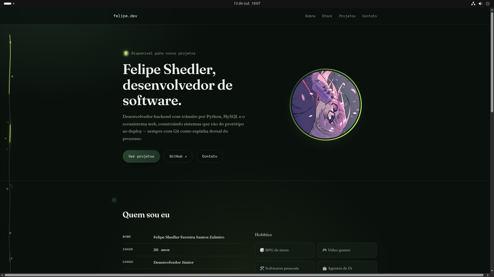
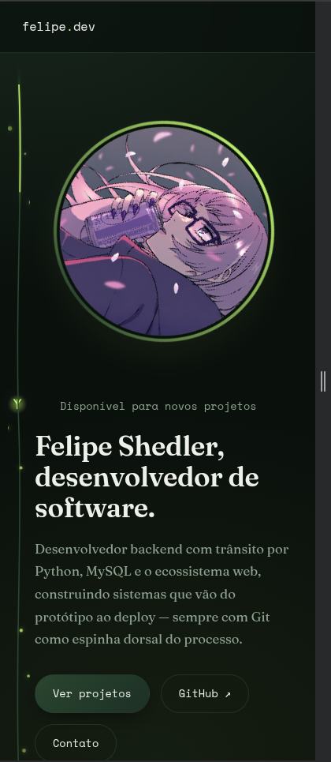

# Portfólio — Felipe Shedler

**Nome completo:** Felipe Shedler Ferreira Santos Zulmiro
**Turma:** 033.2026.0163

**Site publicado:** https://muzgeist.github.io/portfolio/
**Repositório:** https://github.com/Muzgeist/portfolio

## Prints do site

| Desktop | Mobile |
|---|---|
|  |  |

## Onde usei CSS Grid

- **`.hero-grid`** (cabeçalho/hero) — `grid-template-columns` com `fr` e também `grid-template-areas` (`"text photo"`, que vira `"photo" "text"` no breakpoint mobile).
- **`.about-grid`** (seção Sobre mim) — `grid-template-columns: repeat(2, 1fr)` com `gap`.
- **`.hobbies-grid`** (cards de hobbies, dentro de Sobre mim) — `grid-template-columns: repeat(2, 1fr)` com `gap`.
- **`.formacao-grid`** (seção Formação e experiência) — `grid-template-columns: repeat(2, 1fr)` com `gap`.
- **`.skills-grid`** (seção Competências) — `grid-template-columns: repeat(2, 1fr)` com `gap`.

> **Nota sobre a seção Projetos:** por decisão consciente, a galeria de projetos manteve o
> carrossel de rolagem automática em Flexbox que já existia no site (com setas de navegação
> manual e sincronização ao vivo com a API do GitHub). Um Grid tradicional quebra linha e perde
> a rolagem contínua, então optei por preservar essa funcionalidade e reforçar o uso de Grid nas
> demais seções listadas acima em vez de forçá-lo artificialmente nos Projetos.

## Onde usei Flexbox

- **`.nav .wrap`** (menu de navegação) — `justify-content: space-between` e `align-items: center`.
- **`.project-card`** (cards de projeto) — `flex-direction: column` organizando imagem, título, descrição e link/rodapé do card.
- **`.contato-links`** (seção Contato) — `flex-direction: row` no desktop, mudando para `column` no breakpoint mobile (`@media max-width: 800px`).
- **`footer .wrap`** (rodapé) — `justify-content: space-between`, `align-items: center` e `flex-wrap: wrap`.
- **`.projects-track`** (trilho do carrossel de projetos) — `display: flex` com `gap`, base da rolagem automática.
- **`.hero-actions`**, **`.pill-group`**, **`.lang-legend`** — `gap` em componentes menores.

## Funcionalidades extra

- Idade e período do curso calculados dinamicamente via JavaScript.
- Carrossel de projetos sincronizado automaticamente com a API pública do GitHub (com cache local e fallback de erro).
- Modal de detalhes do projeto com gráfico de linguagens do repositório.
- Ilustrações temáticas próprias (SVG) para cada card de projeto, já que os repositórios não têm uma tela pública para capturar — ver `img/projects/`.
- Animação decorativa de "espinha ramificada" com runas (puramente estética, respeita `prefers-reduced-motion`).

## Estrutura de pastas

```
portfolio/
├── index.html
├── README.md
├── css/
│   └── portfolio.css
├── js/
│   └── portfolio.js
└── img/
    ├── Nazuna.png
    ├── readme/
    └── projects/
```
